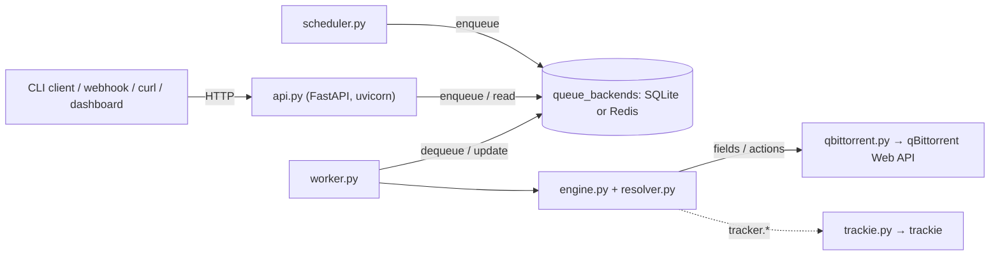

# Architecture Internals

How qbt-rules works inside: for contributors, reviewers and AI assistants. User-facing behaviour belongs on the other pages.

This page maps the codebase itself — which module does what, and how a job crosses process boundaries from HTTP request to qBittorrent API call. If you're looking for the *user-facing* condition/action evaluation model instead, see [Rules Architecture](Rules-Architecture).

## Overview

qbt-rules is one Python package and one binary, `qbt-rules`. Server mode runs one uvicorn process serving the FastAPI app, with a worker thread and a scheduler thread beside it; the worker pulls jobs from a SQLite or Redis queue, evaluates `rules.yml` against qBittorrent's torrents, and calls back into qBittorrent's Web API to act. Everything else (the CLI client, webhooks, cron, the dashboard) only submits jobs or reads results over HTTP.

### Process boundaries

There's one binary (`qbt-rules`) with two roles, chosen by how it's invoked:

- **Server mode** (`qbt-rules serve` / `--serve`): `server.py` runs `api.py`'s FastAPI app under uvicorn, one process. The app's lifespan starts `worker.py` and `scheduler.py` as background threads and, on SIGTERM or SIGINT, stops and joins them before the process exits. This is what runs continuously inside the Docker container.
- **Client mode** (the default, no `serve`): submits a job to a running server over HTTP and, if given a `--client-server-url`/`--client-api-key`, optionally waits for and prints the result (`--wait`). This is what runs when you `docker exec qbt-rules qbt-rules --context X --wait`, or when a script hits the HTTP API with `curl` directly instead.

Nothing in client mode touches qBittorrent directly — it only talks to the server's HTTP API. All qBittorrent access happens inside the server process, via the worker.

Because the server is one process, the scheduler fires once per cron tick and every metric is counted in one place. `server.workers` must be `1`; a higher value is refused at startup.

## Components

| Module | Responsibility |
|--------|-----------------|
| `legacy_cli.py` | The `qbt-rules` entry point today. Parses args and dispatches to either server mode (`serve`/`--serve`) or client mode (default); job-management commands (`--list-jobs`, `--job-status`, `--cancel-job`, `--stats`) |
| `arguments.py` | Centralized `argparse` setup shared by both CLI modes; `--validate`/`--list-rules`; picks the config directory |
| `cli_ui.py` | Table/JSON rendering for the data-display commands; the only place that prints |
| `api.py`, `api_rules.py`, `api_models.py` | The FastAPI app: the JSON API (jobs, health, stats, version, the rules editor's `/api/rules/*` and `/api/config/source`), `/healthz` and `/readyz`, API-key and session auth (see [HTTP API Reference](HTTP-API-Reference)), the `{"error", "message"}` error bodies, and the lifespan that runs the worker and scheduler threads. `api_models.py` describes the responses for the OpenAPI schema |
| `server.py` | Runs the app under uvicorn; the access-log filter (hides polling requests, redacts `key=`) |
| `sessions.py` | The login session shared by the JSON API and the dashboard (Starlette's `SessionMiddleware`, cookie `qbt_rules_session`), and its CSRF token |
| `web.py` | The [Dashboard](Dashboard) pages (`/`, `/jobs`, `/rules`, `/rules/edit`, `/login`), `/static` and, when enabled, `/metrics` (see [Metrics](Metrics)): FastAPI routes on the API's app, rendered with Jinja2, sharing its login session (`sessions.py`) |
| `templates/`, `static/` | Jinja2 templates for the dashboard — server-rendered HTML, no frontend build step — and the rules editor's script |
| `config_store.py` | Reads and writes `rules.yml` for the editor: ETags, conflict detection, the `.history/` of previous versions, a file lock so concurrent saves can't interleave |
| `rules_validation.py` | `rules.yml` validation for the editor and `--validate`: YAML syntax, structure, then the engine's vocabulary |
| `schema.py` | Catalogue of every field namespace, operator and action type the engine implements, shared by the validator and the editor's autocomplete |
| `metrics.py` | Optional Prometheus instrumentation (see [Metrics](Metrics)) — always safe to import even when `prometheus_client` isn't installed, since the actual dependency is only ever imported lazily, deferred until `metrics.init()` runs |
| `worker.py` | Background thread that dequeues jobs and executes them via the engine; graceful shutdown handling |
| `scheduler.py` | Background thread that enqueues a job when a configured cron entry fires — see [Scheduling](Scheduling) |
| `queue_manager.py` | Abstract job-queue interface (`JobStatus` constants, enqueue/dequeue/status contract) |
| `queue_backends/` | Concrete implementations of that interface — SQLite (default) and Redis |
| `engine.py` | `RulesEngine` (orchestrator), `ConditionEvaluator`, and `ActionExecutor` — the actual rule evaluation and action dispatch logic |
| `resolver.py` | `RuleResolver` — expands `$ref:` and substitutes `${vars.x}` before a rule reaches the engine |
| `config.py` | The settings, on [interpose](https://github.com/metalayerlab/interpose): every key, its variable, default and check; plus `${VAR}` expansion, the `server.*` aliases, the schedule, and refusing what 0.11 removed |
| `config_loader.py` | The running configuration: the settings plus `rules.yml`, loaded, validated and hot-reloaded (a missing `rules.yml` is no rules) |
| `qbittorrent.py` | Thin wrapper around the `qbittorrent-api` package — multi-version qBittorrent support |
| `trackie.py` | Client for [trackie](https://github.com/andronics/trackie)'s snapshot, behind the `tracker.*` fields |
| `errors.py` | User-facing exception types with actionable messages (no raw stack traces surfaced to users) |
| `log_setup.py` | Shared logging setup used by every other module |
| `utils.py` | Small stateless helpers: `parse_tags`, `is_older_than`/`is_newer_than`, `is_larger_than`/`is_smaller_than` |
| `__init__.py` | Package version, read from the installed metadata — see [Release Process](Release-Process) |

The template's skeleton modules `cli.py` (Typer) and `api.py` (FastAPI) are in the package too, but nothing runs them yet: later migration steps move the CLI and the HTTP API onto them, and this table changes with each.

### Queue backend abstraction

`queue_manager.py` defines the contract; `queue_backends/` provides SQLite and Redis implementations behind it. `worker.py` and `web.py` only ever talk to the abstract interface, so switching `queue.backend` between `sqlite` and `redis` in `config.yaml` doesn't touch either of them — only which backend module gets instantiated at startup changes. Adding a third backend (e.g. Postgres) means implementing the same interface in a new module under `queue_backends/` and wiring it into that instantiation point; no changes to `worker.py`/`web.py` should be needed.

## Data flow

1. A job arrives at `api.py` (`POST /api/execute`) or via the CLI client, which is really just an HTTP request under the hood — or `scheduler.py` enqueues one directly on a cron tick, bypassing the HTTP layer entirely (no API key check needed, since it's not going over the network). The API key is checked for every other submission path before anything else happens.
2. Either way, the job (context, optional hash) reaches `queue_manager.py`, which persists it through whichever backend is configured (`queue_backends/sqlite_queue.py` or `redis_queue.py`) with status `pending`.
3. `worker.py`'s background thread dequeues the job, marks it `processing`, and loads `rules.yml` through `config_loader.py` — which also initializes `resolver.py`'s `RuleResolver` if a `refs:` block is present.
4. For each rule, the resolver expands any `$ref:`/`${vars.x}` before the rule reaches `engine.py`. The engine's `ConditionEvaluator` checks `enabled`, then context, then evaluates `conditions:` per torrent (fetched via `qbittorrent.py`); matches are handed to `ActionExecutor`, which calls back into `qbittorrent.py` to actually act on qBittorrent.
5. The worker updates the job's status (`completed`/`failed`) and result summary back through `queue_manager.py`, which is what `--job-status`/`--list-jobs` (via the client) or `GET /api/jobs` read back.

**Where state lives:** jobs and their results in the queue (`qbt-rules.db` in the state directory, or Redis); `config.yaml` and `rules.yml` in `/etc/qbt-rules`, the editor's `.history/` in the state directory, the log on the console (see [In-Depth Configuration](In-Depth-Configuration#where-configuration-comes-from)). Nothing else is persisted: torrent fields are fetched fresh from qBittorrent for every job, and trackie's snapshot once per job that uses `tracker.*`.

## Design decisions

Why things are the way they are is recorded in [docs/design/](https://github.com/andronics/qbt-rules/tree/main/docs/design). Rejected ideas and the reasons are in [TODO.md](https://github.com/andronics/qbt-rules/blob/main/TODO.md) under "Decided against".

The decisions that shape the code most, from before design records were kept:

- **Client-server, with a persistent queue.** Every trigger (webhook, cron, manual, dashboard) becomes a queued job, so triggers are cheap and fire-and-forget, a burst of webhooks can't run rules concurrently against the same torrents, and jobs survive restarts.
- **File order is execution order.** No priority field: what you read top to bottom is what runs ([Rules Architecture](Rules-Architecture)).
- **Free-form contexts.** No fixed list of triggers: a context is any string the submitter and the rule agree on ([Contexts](Contexts)).
- **Resolve references before the engine.** `$ref`/`${vars.x}` are expanded by `resolver.py`, so the engine only ever sees plain rules ([Reusable References](Reusable-References)).
- **Idempotent actions.** Actions skip work that's already done, so re-running a context is always safe ([Actions](Actions)).
- **Fail safe on missing data.** A `tracker.*` field with missing or stale trackie data skips the rule for that torrent rather than matching on a guess ([Available Fields](Available-Fields)).
