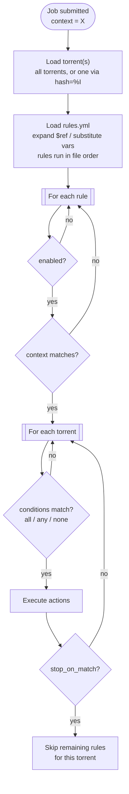

This page walks through what actually happens when a job runs — from the moment it's submitted to the moment actions land on a torrent — plus how conditions are evaluated and how field data is fetched and cached along the way.

### Execution Flow

Every job is a nested loop: **for each enabled, context-matching rule, for each torrent, check the conditions and act if they match.** The diagram below traces that path end to end, including the reference-resolution step that expands any `$ref`/`${vars.x}` in a rule before it's evaluated.



**Reading the diagram:**

- Rounded oval — entry point (job received).
- Double-bordered box — a loop; everything downstream repeats once per item in the set (rules first, then torrents within each matching rule).
- Diamond — a branch; follow the edge matching the outcome.
- Rectangle — a single step, no branching.

**Reference Resolution:** If `rules.yml` has a `refs:` block, every rule's `conditions:`/`actions:` is expanded before evaluation — `$ref: conditions.name`/`$ref: actions.name` are replaced with the structure they point to, and `${vars.x}` placeholders are substituted with their values. This happens once per rule, per job, before that rule is checked against any torrent. See [Reusable References](Reusable-References) for the full mechanics.

### Rule Identity: `id` and `meta.description`

Every rule requires a short, unique `id:` — this is the rule's stable
identity, used wherever qbt-rules needs to identify *which* rule something
is about (the per-rule breakdown in a job's result, `by_rule` — see
[HTTP-API-Reference](HTTP-API-Reference#get-apijobsjob_id) — and
`${rule.id}` in notify templates, see below).

```yaml
rules:
  - id: force-start-public-capped
    meta:
      description: "Force-start queued public torrents, capped at 5 uploading"
    conditions: ...
    actions: ...
```

`id` is deliberately terse and stable — a slug, not a sentence — because
renaming it starts a new identity: any job history/stats tracked under the
old `id` don't carry over to the new one. Duplicate `id`s across rules are
rejected at load time (a silent collision would merge two different rules'
`by_rule` entries under one key).

For the human-readable text `id` intentionally isn't good at, set the
optional `meta.description` on the rule. It's used in logs, the read-only
dashboard, and CLI output (`--list-rules`) whenever present, falling back to
`id` when it isn't:

```yaml
rules:
  - id: force-start-public-capped
    meta:
      description: "Force-start queued public torrents, capped at 5 uploading"
```

This is a *different* `meta` from `refs.meta.conditions.*`/
`refs.meta.actions.*` (see [Reusable-References](Reusable-References#metadata-refsmeta))
— that one describes a reusable `$ref` block; this one is a sibling field
directly on a rule, describing the rule itself. Both exist for the same
reason (giving future tooling somewhere to read/write a description) but
they're unrelated namespaces that happen to share a name.

**Prior to v0.7** rules used a required `name:` field instead, and `id`
was optional. `name` no longer exists — see the
[CHANGELOG](https://github.com/andronics/qbt-rules/blob/main/CHANGELOG.md)
if you're upgrading a `rules.yml` written against an older version;
every `- name: "..."` becomes `- id: <slug>` with the old text moved to
`meta.description`.

### Condition Evaluation Logic

Rules support three logical groups that can be combined:

- **`all`:** Every condition in the list must be true (**AND** logic)
- **`any`:** At least one condition must be true (**OR** logic)
- **`none`:** No conditions can be true (**NOT** logic)

**Evaluation Order:**

1. All three groups are evaluated independently
2. The rule matches only if **all groups pass**
3. Empty/missing groups are skipped (treated as pass)

**Examples:**

```yaml
# Only "all" group
conditions:
  all:
    - field: info.ratio
      operator: ">="
      value: 2.0
    - field: info.state
      operator: ==
      value: uploading
# Result: ratio >= 2.0 AND state = uploading
```

```yaml
# Only "any" group
conditions:
  any:
    - field: info.state
      operator: ==
      value: error
    - field: info.state
      operator: ==
      value: missingFiles
# Result: state = error OR state = missingFiles
```

```yaml
# Combining groups
conditions:
  all:
    - field: info.ratio
      operator: ">="
      value: 2.0
  none:
    - field: info.category
      operator: ==
      value: keep
# Result: (ratio >= 2.0) AND NOT (category = keep)
```

```yaml
# Complex combination
conditions:
  all:
    - field: info.size
      operator: ">"
      value: 10737418240  # 10 GB
  any:
    - field: info.name
      operator: contains
      value: "1080p"
    - field: info.name
      operator: contains
      value: "2160p"
  none:
    - field: info.category
      operator: in
      value: [keep, seedbox]
# Result: (size > 10GB) AND (name has 1080p OR 2160p) AND NOT (category in [keep, seedbox])
```

### Field Resolution & Caching

The engine uses **dot notation** to access different qBittorrent API endpoints efficiently.

**Dot Notation Format:** `endpoint.property`

**Examples:**

- `info.name` → Torrent name from torrents/info endpoint
- `trackers.url` → Tracker URLs from torrents/trackers endpoint
- `files.name` → File names from torrents/files endpoint

**API Call Patterns:**

| Field Category | API Endpoint | When Called | Cache Scope | Cost |
|----------------|--------------|-------------|-------------|------|
| `info.*` | /torrents/info | Pre-loaded | Per execution | **Free** |
| `trackers.*` | /torrents/trackers | First use per torrent | Per execution | 1 call/torrent |
| `files.*` | /torrents/files | First use per torrent | Per execution | 1 call/torrent |
| `peers.*` | /sync/torrentPeers | First use per torrent | Per execution | 1 call/torrent |
| `properties.*` | /torrents/properties | First use per torrent | Per execution | 1 call/torrent |
| `webseeds.*` | /torrents/webseeds | First use per torrent | Per execution | 1 call/torrent |
| `transfer.*` | /transfer/info | First use (global) | Per execution | 1 call total |
| `app.*` | /app/preferences | First use (global) | Per execution | 1 call total |

**Caching Behavior:**

- **info.***: Already loaded, zero cost
- **Per-torrent fields**: Called once per torrent, then cached for that execution
- **Global fields**: Called once total, shared across all torrents

**Performance Tips:**

- Use `info.*` fields whenever possible (free)
- Avoid expensive fields (`files.*`, `trackers.*`) in high-frequency webhooks
- Global fields (`transfer.*`, `app.*`) are cheap to use

**Collection Field Behavior:**

Some fields return **lists** (collections):

- `trackers.*` - List of trackers
- `files.*` - List of files
- `peers.*` - List of peers
- `webseeds.*` - List of web seeds

**Positive operators check if ANY item matches:**

```yaml
- field: trackers.url
  operator: contains
  value: ".private"
# Returns TRUE if ANY tracker URL contains ".private"
```

```yaml
- field: files.name
  operator: matches
  value: '(?i)\.rar$'
# Returns TRUE if ANY file name ends with .rar
```

**Negation operators (`!=`, `not_in`, `not_contains`) are the exception — they check if ALL items satisfy the negation:**

```yaml
- field: trackers.url
  operator: not_contains
  value: ".private"
# Returns TRUE only if NO tracker URL contains ".private" (i.e. every item fails to match)
```

If ANY-match semantics applied here too, a torrent with even one non-matching tracker would trivially satisfy the negation, which defeats the point of the check. See [Conditions](Conditions) for a worked example.
